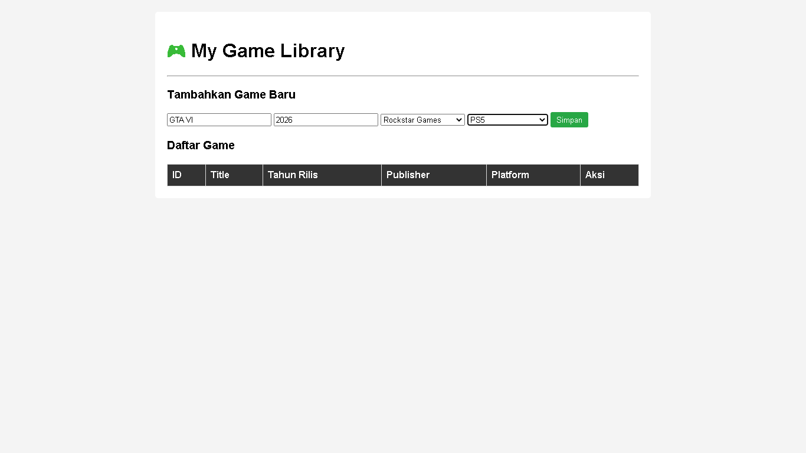
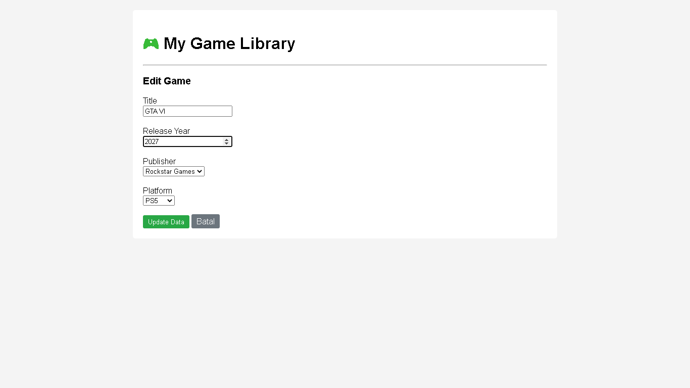
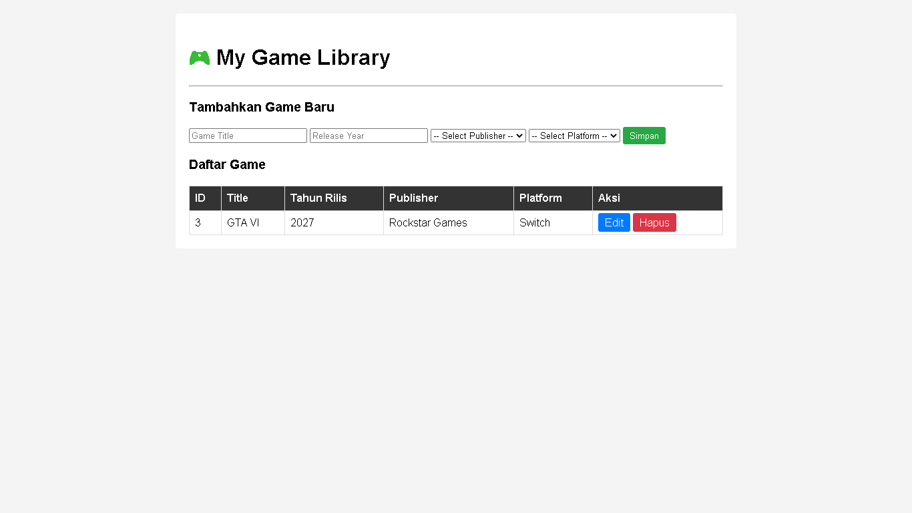
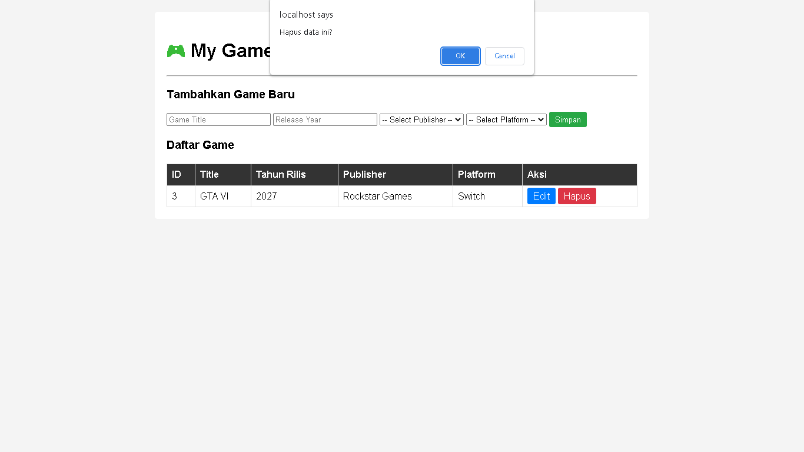

# TP7DPBO2526C1
## JANJI
Saya Louis Marcel Wendy Adrianto dengan NIM 2509068 mengerjakan Tugas Praktikum 7 pada Mata Kuliah Desain dan Pemrograman Berorientasi Objek (DPBO) untuk keberkahan-Nya maka saya tidak melakukan kecurangan seperti yang telah dispesifikasikan. Aamiin

## STRUKTUR KODE 
game_library
- class
  - Game.php
  - Publisher.php
  - Platform.php
- config
  - Database.php
- database
  - game_library.sql
- style
  - style.css
- view
  - header.php
  - footer.php
- index.php
- edit.php

## STRUKTUR KELAS
Data pada mysql tersebut merupakan tiga kelas : 
### Game
* id
* title
* release_year
* publisher_id
* platform_id
### Publisher
* id
* name
* country
### Platform
* id
* name
* manufacturer

## ALUR
### Titik Awal (Entry Point) di index.php
Saat pengguna membuka web, file index.php adalah yang pertama kali dijalankan. File ini bertindak sebagai "Controller" utama.

### Inisialisasi & Koneksi 
Databaseindex.php akan memuat file config/Database.php dan file-file di folder class/. Program kemudian membuat koneksi database dan memasukkan (inject) koneksi tersebut ke dalam objek Game, Publisher, dan Platform agar mereka bisa berinteraksi dengan database.

### Penanganan Aksi (Proses CRUD)
Program mengecek apakah pengguna melakukan aksi tertentu:
* Jika ada request POST (pengguna menekan tombol "Simpan"), program mengambil data dari form dan memanggil fungsi $gameObj->create() untuk menyimpan data.
* Jika ada request GET (pengguna menekan tombol "Hapus"), program memanggil $gameObj->delete() berdasarkan ID yang dikirim.
Setelah aksi selesai, halaman akan di-refresh (redirect) untuk mencegah pengiriman ulang data.
* Jika ada request UPDATE, pengguna masuk ke edit.php lalu menyimpan perubahan form, data ditangkap via POST dan program memanggil $gameObj->update().

### Pengambilan Data (Read)
Jika tidak ada aksi (atau setelah aksi selesai), program akan memanggil metode read() dari class Game, Publisher, dan Platform. Di tahap ini, Prepared Statement PDO mengeksekusi query secara aman dan mengembalikan data dari database.

### Menampilkan Halaman (View)
Terakhir, index.php merakit tampilan:
* Memanggil view/header.php untuk bagian atas HTML.
* Menampilkan form input (mengisi opsi dropdown menggunakan data publisher & platform).
* Melakukan looping (perulangan) pada data game untuk menampilkannya di dalam tabel.
* Menutup tampilan dengan memanggil view/footer.php.

## DOKUMENTASI

